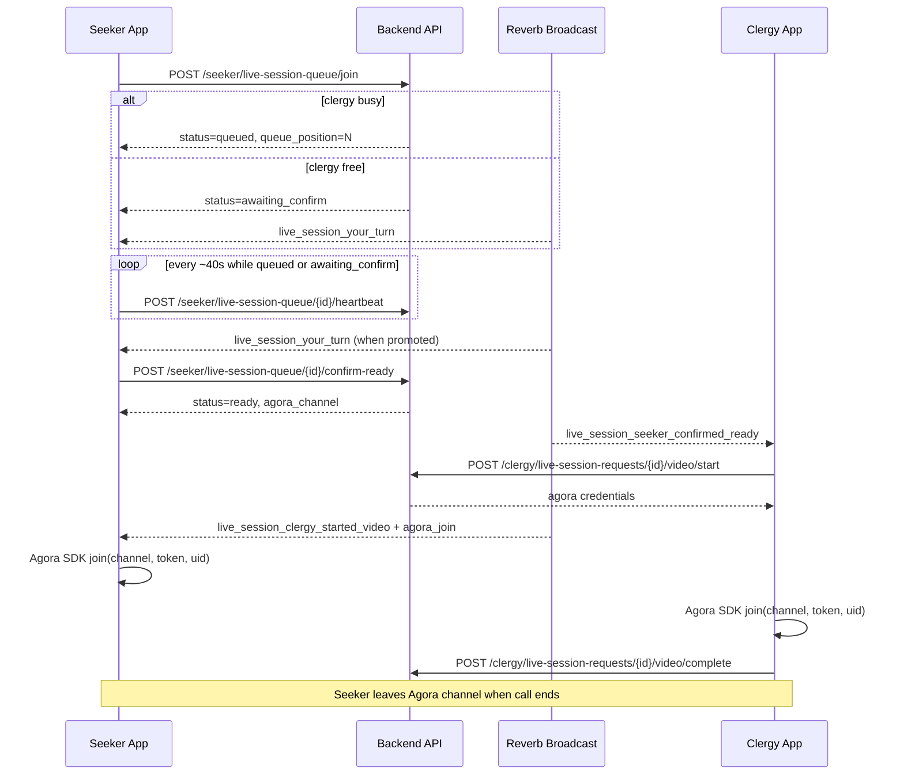
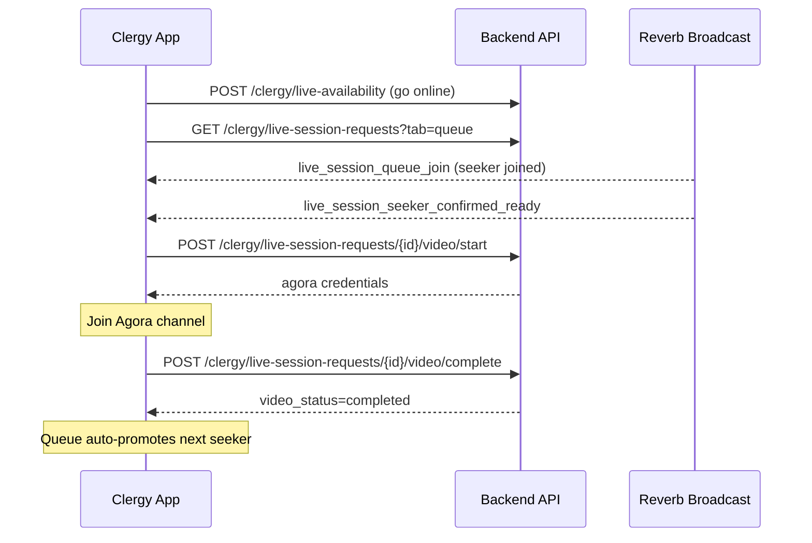
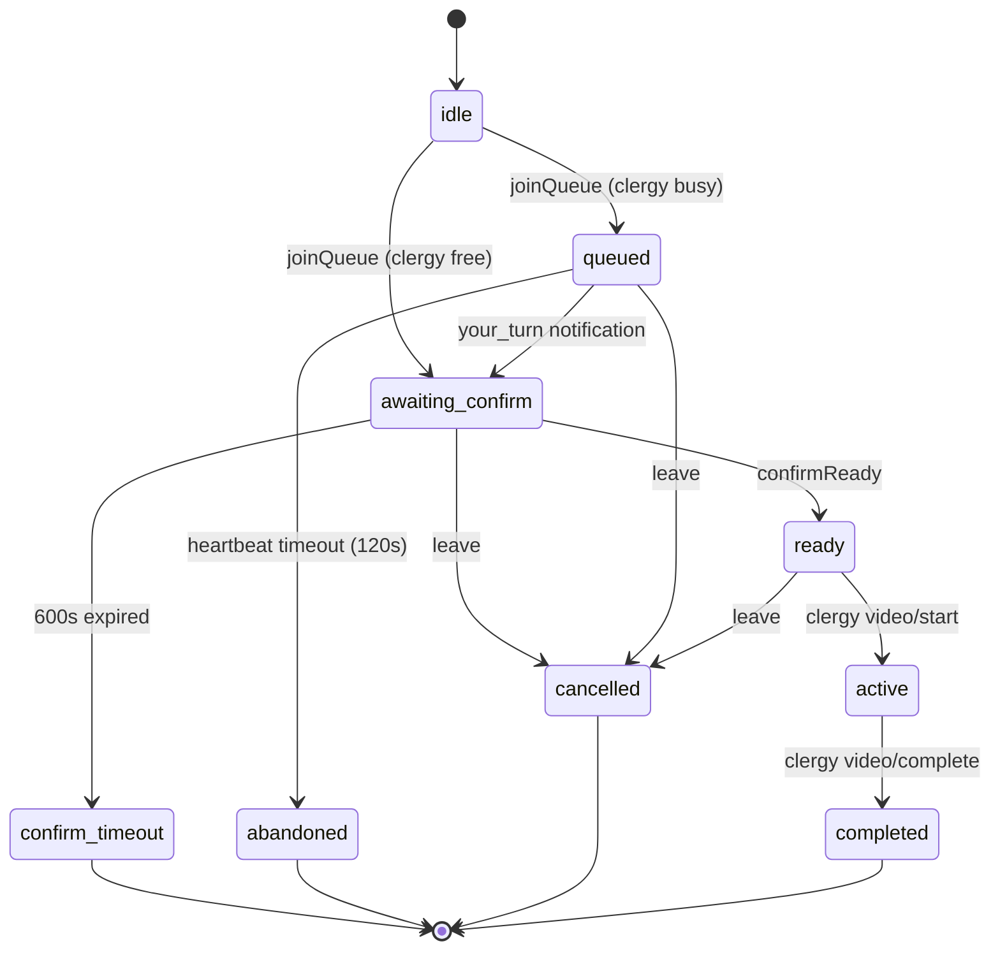

# Live Session — Frontend Integration Guide

Complete implementation reference for the **Live Session Queue + Agora Video Call** feature.

Give this document to your frontend developer (or AI assistant). It contains every API endpoint, real-time event, status transition, and Agora join step needed to build the feature end-to-end.

---

## Table of Contents

1. [Overview](#1-overview)
2. [Architecture](#2-architecture)
3. [Environment Setup](#3-environment-setup)
4. [Authentication](#4-authentication)
5. [API Response Format](#5-api-response-format)
6. [Status Reference](#6-status-reference)
7. [Seeker Flow](#7-seeker-flow)
8. [Clergy Flow](#8-clergy-flow)
9. [API Endpoints — Seeker](#9-api-endpoints--seeker)
10. [API Endpoints — Clergy](#10-api-endpoints--clergy)
11. [API Endpoints — Shared (Agora)](#11-api-endpoints--shared-agora)
12. [Real-Time Notifications (Broadcast)](#12-real-time-notifications-broadcast)
13. [Agora Video Integration](#13-agora-video-integration)
14. [Recommended Routes & Screens](#14-recommended-routes--screens)
15. [State Machine](#15-state-machine)
16. [Timers & Heartbeat](#16-timers--heartbeat)
17. [Error Handling](#17-error-handling)
18. [Implementation Checklist](#18-implementation-checklist)

---

## 1. Overview

Live Session lets a **seeker** join a **clergy's** live video queue, wait for their turn, confirm readiness, and join an **Agora RTC** video call started by the clergy.

### Roles

| Role | Description |
|------|-------------|
| **Seeker** | Joins queue, sends heartbeat, confirms ready, joins video call |
| **Clergy** | Manages queue, toggles availability, starts/ends Agora call |

### High-level steps

1. Seeker joins queue for a clergy member.
2. When it is their turn, seeker confirms "I am ready".
3. Clergy sees seeker is ready and clicks **Start Video Call**.
4. Backend generates Agora tokens and broadcasts join credentials to the seeker.
5. Both sides join the same Agora channel.
6. Clergy ends the call → next seeker is promoted automatically.

---

## 2. Architecture

```
┌─────────────────┐     REST API (JWT)      ┌──────────────────┐
│  Frontend App   │ ◄──────────────────────►│  Laravel Backend │
│  (Seeker/Clergy)│                         │  /api/...        │
└────────┬────────┘                         └────────┬─────────┘
         │                                         │
         │  WebSocket (Laravel Echo + Reverb)       │
         │ ◄───────────────────────────────────────┤
         │  private-App.Models.User.{userId}       │
         │                                         │
         │  Agora RTC SDK                          │
         └────────────────────────────────────────►│ Agora Cloud
              channel + token + uid                 │
```

### What the frontend owns

- UI / navigation
- JWT storage
- Laravel Echo connection
- Agora SDK (`app_id` stored once in frontend env)
- Camera/microphone permissions

### What the backend owns

- Queue logic & status transitions
- Agora **token** generation (never expose App Certificate to frontend)
- Real-time notifications via Reverb

---

## 3. Environment Setup

### Frontend `.env`

```env
# API
VITE_API_BASE_URL=https://api.yourdomain.com/api

# Agora — set ONCE, reuse everywhere (public value)
VITE_AGORA_APP_ID=your_agora_app_id

# Laravel Reverb (WebSocket)
VITE_REVERB_APP_KEY=your_reverb_key
VITE_REVERB_HOST=api.yourdomain.com
VITE_REVERB_PORT=443
VITE_REVERB_SCHEME=https
```

> **Important:** Backend responses do **NOT** include `app_id`. Configure `VITE_AGORA_APP_ID` once on the frontend and pass it to the Agora SDK on every `join()` call.

### Recommended packages

| Stack | HTTP | WebSocket | Video |
|-------|------|-----------|-------|
| React / Vue | axios or fetch | `laravel-echo` + `pusher-js` | `agora-rtc-sdk-ng` |
| React Native | axios | `laravel-echo` + `pusher-js` | `react-native-agora` |
| Flutter | dio | `pusher_channels_flutter` | `agora_rtc_engine` |

---

## 4. Authentication

All live session endpoints require JWT authentication.

```
Authorization: Bearer <jwt_token>
Content-Type: application/json
Accept: application/json
```

### Role-based route prefixes

| Role | Prefix | Middleware |
|------|--------|------------|
| Seeker | `/api/seeker/...` | `auth:api` + seeker role |
| Clergy | `/api/clergy/...` | `auth:api` + approved clergy |
| Both | `/api/live-session-requests/...` | `auth:api` (session participant check) |

### Broadcast auth

Echo private channels require authorization:

```
POST /api/broadcasting/auth
Authorization: Bearer <jwt_token>
```

Channel to subscribe:

```
private-App.Models.User.{userId}
```

Where `{userId}` is the logged-in user's numeric ID.

---

## 5. API Response Format

### Success

```json
{
  "status": true,
  "message": "Human readable message",
  "code": 200,
  "data": { }
}
```

### Error

```json
{
  "status": false,
  "message": "Human readable error",
  "code": 409,
  "errors": []
}
```

### Paginated list

```json
{
  "status": true,
  "message": "...",
  "code": 200,
  "data": [ ],
  "pagination": {
    "current_page": 1,
    "last_page": 3,
    "per_page": 15,
    "total": 42,
    "next_page_url": "...",
    "prev_page_url": null
  }
}
```

---

## 6. Status Reference

### `status` (live session request)

| Value | Meaning | Who acts next |
|-------|---------|---------------|
| `queued` | Waiting in line | Seeker waits; send heartbeat |
| `awaiting_confirm` | Seeker's turn; must confirm ready | Seeker taps "I am ready" |
| `ready` | Seeker confirmed; waiting for clergy to start call | Clergy taps "Start Video" |
| `active` | Video call in progress | Clergy ends call when done |
| `completed` | Session finished | — |
| `cancelled` | Seeker left voluntarily | — |
| `abandoned` | Removed due to inactivity | — |
| `confirm_timeout` | Seeker did not confirm in time | — |

### `video_status`

| Value | Meaning |
|-------|---------|
| `not_started` | No video yet |
| `started` | Call active |
| `completed` | Call ended |

### Timing constants (from backend)

| Constant | Seconds | Usage |
|----------|---------|-------|
| Heartbeat timeout | **120** | Seeker removed if no heartbeat for 2 minutes |
| Confirm ready window | **600** | Seeker must confirm within 10 minutes |
| Suggested heartbeat interval | **~40** | `heartbeat_timeout / 3` (returned on join) |
| Agora token TTL | **3600** | Token refresh via join endpoint |

---

## 7. Seeker Flow



### Seeker screens

| # | Screen | Trigger |
|---|--------|---------|
| 1 | Join Live Session | User taps join on clergy profile |
| 2 | Queue Waiting | `status === 'queued'` |
| 3 | Confirm Ready | `status === 'awaiting_confirm'` |
| 4 | Waiting for Clergy | `status === 'ready'` |
| 5 | Video Call | `status === 'active'` or `live_session_clergy_started_video` notification |

---

## 8. Clergy Flow



### Clergy screens

| # | Screen | Trigger |
|---|--------|---------|
| 1 | Live Dashboard | Queue tab with availability toggle |
| 2 | Current Session | `current_session` in queue snapshot |
| 3 | Video Call | After start API succeeds |
| 4 | History | `?tab=history` or paginated list |

---

## 9. API Endpoints — Seeker

Base: `/api/seeker`  
Auth: JWT + seeker role

---

### 9.1 Join Queue

```
POST /api/seeker/live-session-queue/join
```

**Body:**

```json
{
  "clergy_id": 5,
  "message": "Optional message to clergy (max 5000 chars)"
}
```

**Success `201`:**

```json
{
  "status": true,
  "message": "Joined live session queue",
  "code": 201,
  "data": {
    "live_session_request": {
      "id": 42,
      "seeker_id": 10,
      "clergy_id": 5,
      "status": "queued",
      "video_status": "not_started",
      "message": "Optional message",
      "queue_joined_at": "2026-06-24T10:00:00.000000Z",
      "confirmation_deadline_at": null,
      "clergyProfile": { }
    },
    "queue_position": 3,
    "heartbeat_interval_seconds": 40
  }
}
```

If clergy has no blocking session, `status` will be `awaiting_confirm` and `queue_position` will be `null`.

**Errors:**

| Code | Message |
|------|---------|
| 409 | You are already in a live session queue. |
| 422 | This clergy member is not available for live sessions. |
| 422 | This clergy member is not online for live sessions right now. |

**Frontend action:**

- Save `live_session_request.id`
- Start heartbeat timer
- Navigate to waiting or confirm screen based on `status`

---

### 9.2 Heartbeat

```
POST /api/seeker/live-session-queue/{id}/heartbeat
```

No body required.

**Success `200`:**

```json
{
  "status": true,
  "message": "Heartbeat recorded",
  "code": 200,
  "data": {
    "live_session_request_id": 42,
    "last_queue_heartbeat_at": "2026-06-24T10:01:00.000000Z"
  }
}
```

**When to call:** Every `heartbeat_interval_seconds` (~40s) while `status` is `queued` or `awaiting_confirm`.

**If missed for 120 seconds:** Backend sets status to `abandoned` and sends `live_session_queue_abandoned` notification.

---

### 9.3 Leave Queue

```
POST /api/seeker/live-session-queue/{id}/leave
```

**Success `200`:**

```json
{
  "status": true,
  "message": "Left live session queue",
  "code": 200
}
```

Allowed when status is `queued`, `awaiting_confirm`, or `ready`.

---

### 9.4 Confirm Ready

```
POST /api/seeker/live-session-queue/{id}/confirm-ready
```

**Success `200`:**

```json
{
  "status": true,
  "message": "Ready confirmed. The clergy has been notified. Waiting for them to start the video call.",
  "code": 200,
  "data": {
    "live_session_request": { "id": 42, "status": "ready", "agora_channel": "live_5_42_abc123de" },
    "status": "ready",
    "agora_channel": "live_5_42_abc123de",
    "ready_confirmed_at": "2026-06-24T10:05:00.000000Z"
  }
}
```

**Errors:**

| Code | Message |
|------|---------|
| 409 | The confirmation window has expired. |
| 409 | Unable to confirm for this record. |

**Frontend action:**

- Show "Waiting for clergy to start the call..."
- Listen for `live_session_clergy_started_video` notification

---

### 9.5 List Live Sessions

```
GET /api/seeker/live-session-requests?per_page=15
```

**Success `200`:** Paginated list of seeker's live session records.

Use on app reopen to restore active session state. Look for records where `status` is in: `queued`, `awaiting_confirm`, `ready`, `active`.

---

### 9.6 Show Live Session

```
GET /api/seeker/live-session-requests/{id}
```

**Success `200`:** Single live session record with clergy profile.

---

## 10. API Endpoints — Clergy

Base: `/api/clergy`  
Auth: JWT + approved clergy profile

---

### 10.1 Queue Snapshot (Dashboard)

```
GET /api/clergy/live-session-requests?tab=queue
```

**Success `200`:**

```json
{
  "status": true,
  "message": "Live session queue snapshot",
  "code": 200,
  "data": {
    "stats": {
      "waiting_in_queue": 2,
      "open_prayer_threads": 1,
      "sessions_this_week": 5
    },
    "is_available_for_live": true,
    "live_unavailable_message": null,
    "heartbeat_timeout_seconds": 120,
    "confirm_ready_seconds": 600,
    "current_session": {
      "id": 42,
      "status": "ready",
      "status_label": "CONFIRMED READY",
      "badges": ["SEEKING LIVE SESSION", "CONFIRMED READY"],
      "subtitle": "Waiting room confirmed and ready.",
      "queue_position": null,
      "is_next": false,
      "seeker": { "id": 10, "name": "John", "email": "...", "avatar": "..." },
      "message": "Need guidance",
      "ready_confirmed_at": "2026-06-24T10:05:00.000000Z",
      "confirmation_deadline_at": null,
      "agora_channel": "live_5_42_abc123de",
      "can_start_agora_call": true,
      "video_status": "not_started"
    },
    "queue": [
      {
        "id": 43,
        "status": "queued",
        "status_label": "IN QUEUE",
        "queue_position": 1,
        "is_next": true,
        "seeker": { },
        "message": "..."
      }
    ],
    "can_notify_next_seeker": true
  }
}
```

**Poll this endpoint** every 10–15 seconds as a fallback if WebSocket disconnects.

---

### 10.2 Live Session History

```
GET /api/clergy/live-session-requests?tab=history&per_page=15
```

Paginated past sessions (default tab is `queue`).

---

### 10.3 Show Live Session

```
GET /api/clergy/live-session-requests/{id}
```

---

### 10.4 Toggle Live Availability

```
POST /api/clergy/live-availability
```

**Body:**

```json
{
  "is_available_for_live": true,
  "live_unavailable_message": null
}
```

When going offline (`false`), optional message:

```json
{
  "is_available_for_live": false,
  "live_unavailable_message": "Back in 30 minutes"
}
```

Seekers in queue receive `clergy_live_step_out` notification.

---

### 10.5 Notify Next Seeker

```
POST /api/clergy/live-session-queue/notify-next
```

Reminds current `awaiting_confirm` seeker or promotes next `queued` seeker.

**Success `200`:**

```json
{
  "status": true,
  "message": "Next seeker has been notified to confirm they are ready.",
  "code": 200,
  "data": {
    "action": "promoted",
    "live_session_request": { }
  }
}
```

`action` is either `reminded` or `promoted`.

**Errors:**

| Code | Message |
|------|---------|
| 409 | A seeker is already ready or in a live call. Start or complete it first. |
| 404 | No seekers are waiting in your queue. |

---

### 10.6 Start Video Call

```
POST /api/clergy/live-session-requests/{id}/video/start
```

**Precondition:** `status` must be `ready`.

**Success `200`:**

```json
{
  "status": true,
  "message": "Video started successfully",
  "code": 200,
  "data": {
    "live_session_request_id": 42,
    "chat_room_id": 7,
    "agora_channel": "live_5_42_abc123de",
    "video_status": "started",
    "agora": {
      "channel": "live_5_42_abc123de",
      "uid": 5,
      "token": "007eJx...",
      "expires_at": "2026-06-24T11:05:00.000000Z",
      "live_session_request_id": 42,
      "join_url": "https://your-frontend.com/live/call/42"
    }
  }
}
```

> `agora` object is only present when Agora is configured on the server.

**Frontend action:**

1. Use `data.agora` to join Agora immediately
2. Navigate to call screen

**Errors:**

| Code | Message |
|------|---------|
| 409 | The seeker must confirm they are ready before you can start the call. |
| 409 | Video already started / completed |

---

### 10.7 Complete Video Call

```
POST /api/clergy/live-session-requests/{id}/video/complete
```

**Precondition:** `video_status` must be `started`.

**Success `200`:**

```json
{
  "status": true,
  "message": "Video completed successfully",
  "code": 200,
  "data": {
    "live_session_request_id": 42,
    "chat_room_id": 7,
    "video_status": "completed"
  }
}
```

**Frontend action:**

1. Leave Agora channel
2. Release camera/mic tracks
3. Refresh queue snapshot (next seeker auto-promoted by backend)

---

## 11. API Endpoints — Shared (Agora)

Available to **both seeker and clergy** if they are a participant of the session.

```
GET /api/live-session-requests/{id}/agora/join
```

Auth: JWT (any authenticated user who is seeker or clergy of this session)

**Precondition:** `status` is `ready` or `active`, and video is not completed.

**Success `200`:**

```json
{
  "status": true,
  "message": "Agora join credentials generated",
  "code": 200,
  "data": {
    "agora": {
      "channel": "live_5_42_abc123de",
      "uid": 10,
      "token": "007eJx...",
      "expires_at": "2026-06-24T11:05:00.000000Z",
      "live_session_request_id": 42,
      "join_url": "https://your-frontend.com/live/call/42"
    }
  }
}
```

### When to use

| Scenario | Source |
|----------|--------|
| Clergy starts call | `video/start` response → `data.agora` |
| Seeker receives broadcast | `notification.agora_join` |
| Token expired mid-call | `GET .../agora/join` |
| App reopened during active call | `GET .../agora/join` |
| Broadcast missed | `GET .../agora/join` |

### `agora` object fields

| Field | Type | Description |
|-------|------|-------------|
| `channel` | string | Agora channel name |
| `uid` | int \| string | Must use **exact same value** in Agora `join()` |
| `token` | string | RTC token (server-signed, short-lived) |
| `expires_at` | ISO 8601 | When to refresh token |
| `live_session_request_id` | int | Session ID |
| `join_url` | string | Deep link to your call screen |

> **`app_id` is NOT included.** Use `VITE_AGORA_APP_ID` from frontend env.

---

## 12. Real-Time Notifications (Broadcast)

### Setup Laravel Echo

```javascript
import Echo from 'laravel-echo';
import Pusher from 'pusher-js';

window.Pusher = Pusher;

const echo = new Echo({
  broadcaster: 'reverb',
  key: import.meta.env.VITE_REVERB_APP_KEY,
  wsHost: import.meta.env.VITE_REVERB_HOST,
  wsPort: import.meta.env.VITE_REVERB_PORT ?? 80,
  wssPort: import.meta.env.VITE_REVERB_PORT ?? 443,
  forceTLS: (import.meta.env.VITE_REVERB_SCHEME ?? 'https') === 'https',
  enabledTransports: ['ws', 'wss'],
  authEndpoint: `${import.meta.env.VITE_API_BASE_URL}/broadcasting/auth`,
  auth: {
    headers: {
      Authorization: `Bearer ${getJwtToken()}`,
    },
  },
});

echo.private(`App.Models.User.${userId}`)
  .notification((notification) => {
    handleNotification(notification);
  });
```

### Notification handler (switch on `type`)

```javascript
function handleNotification(n) {
  switch (n.type) {
    case 'live_session_your_turn':
      // Seeker: navigate to confirm-ready screen
      break;
    case 'live_session_seeker_confirmed_ready':
      // Clergy: enable "Start Video" button
      break;
    case 'live_session_clergy_started_video':
      // Seeker: join Agora with n.agora_join
      joinAgoraCall(n.agora_join);
      break;
    case 'live_session_confirm_timeout':
    case 'live_session_queue_abandoned':
      // Seeker: show removed message, clear queue state
      break;
    case 'live_session_queue_join':
      // Clergy: refresh queue snapshot
      break;
    case 'clergy_live_step_out':
      // Seeker: show clergy offline message
      break;
  }
}
```

### All notification types

#### Seeker notifications

| `type` | Title | Key fields | Action |
|--------|-------|------------|--------|
| `live_session_your_turn` | You are up for a live session | `request_id` | Go to confirm screen |
| `live_session_clergy_started_video` | Live session started | `request_id`, `agora_channel`, `agora_join` | Join Agora call |
| `live_session_confirm_timeout` | Live session slot expired | `request_id` | Show timeout, clear state |
| `live_session_queue_abandoned` | Removed from live session queue | `request_id`, `message` | Show reason, clear state |
| `clergy_live_step_out` | Clergy temporarily unavailable | `clergy_id`, `message` | Inform user |

#### Clergy notifications

| `type` | Title | Key fields | Action |
|--------|-------|------------|--------|
| `live_session_queue_join` | Seeker joined your live queue | `request_id` | Refresh queue |
| `live_session_seeker_confirmed_ready` | Seeker is ready | `request_id`, `agora_channel` | Enable start button |

### `live_session_clergy_started_video` payload (full)

```json
{
  "type": "live_session_clergy_started_video",
  "title": "Live session started",
  "message": "The clergy started the video call. Join now.",
  "request_type": "live_session_queue",
  "request_id": 42,
  "agora_channel": "live_5_42_abc123de",
  "url": "https://your-frontend.com/live/call/42",
  "agora_join": {
    "channel": "live_5_42_abc123de",
    "uid": 10,
    "token": "007eJx...",
    "expires_at": "2026-06-24T11:05:00.000000Z",
    "live_session_request_id": 42,
    "join_url": "https://your-frontend.com/live/call/42"
  },
  "thumbnail": "https://api.yourdomain.com/backend/admin/assets/images/messages_user.png"
}
```

### Fallback: poll notifications

If WebSocket is unavailable:

```
GET /api/my-notifications
Authorization: Bearer <jwt>
```

Mark as read:

```
POST /api/my-notifications/mark-as-read
Body: { "notification_ids": ["uuid-1", "uuid-2"] }
```

---

## 13. Agora Video Integration

### 13.1 Configuration

```javascript
// config/agora.js
export const AGORA_APP_ID = import.meta.env.VITE_AGORA_APP_ID;
```

### 13.2 Join call (Web — agora-rtc-sdk-ng)

```javascript
import AgoraRTC from 'agora-rtc-sdk-ng';
import { AGORA_APP_ID } from './config/agora';

let client = null;
let localAudioTrack = null;
let localVideoTrack = null;

export async function joinAgoraCall(agoraJoin) {
  const { channel, uid, token } = agoraJoin;

  client = AgoraRTC.createClient({ mode: 'rtc', codec: 'vp8' });

  client.on('user-published', async (user, mediaType) => {
    await client.subscribe(user, mediaType);
    if (mediaType === 'video') {
      // play remote video: user.videoTrack.play('remote-video-container')
    }
    if (mediaType === 'audio') {
      user.audioTrack.play();
    }
  });

  client.on('user-unpublished', (user) => {
    // remove remote video UI
  });

  // Token about to expire — refresh from API
  client.on('token-privilege-will-expire', async () => {
    const fresh = await fetchAgoraJoin(agoraJoin.live_session_request_id);
    await client.renewToken(fresh.token);
  });

  await client.join(AGORA_APP_ID, channel, token, uid);

  [localAudioTrack, localVideoTrack] = await AgoraRTC.createMicrophoneAndCameraTracks();
  await client.publish([localAudioTrack, localVideoTrack]);

  // localVideoTrack.play('local-video-container');
}

export async function leaveAgoraCall() {
  localAudioTrack?.close();
  localVideoTrack?.close();
  await client?.leave();
  client = null;
}

async function fetchAgoraJoin(sessionId) {
  const res = await fetch(`${API_BASE}/live-session-requests/${sessionId}/agora/join`, {
    headers: { Authorization: `Bearer ${getJwtToken()}` },
  });
  const json = await res.json();
  return json.data.agora;
}
```

### 13.3 Critical rules

1. **Always use the `uid` returned by the backend** — do not invent your own.
2. **`app_id` comes from frontend env only** — never wait for it in API responses.
3. **Token is per-user** — seeker and clergy get different tokens for the same channel.
4. **Refresh token** before `expires_at` or on `token-privilege-will-expire` event.
5. **Both sides are publishers** — enable camera + mic on both seeker and clergy.
6. **Leave channel** when clergy completes the call or user navigates away.

### 13.4 Seeker join trigger priority

```
1. WebSocket notification (agora_join)     ← fastest
2. GET /agora/join API                     ← fallback
3. Poll GET /live-session-requests/{id}    ← status check only
```

---

## 14. Recommended Routes & Screens

### Seeker routes

| Route | Screen |
|-------|--------|
| `/live/join/:clergyId` | Join with message |
| `/live/waiting/:sessionId` | Queue position + leave |
| `/live/confirm/:sessionId` | Confirm ready + countdown |
| `/live/ready/:sessionId` | Waiting for clergy |
| `/live/call/:sessionId` | Agora video UI |

### Clergy routes

| Route | Screen |
|-------|--------|
| `/clergy/live` | Queue dashboard |
| `/clergy/live/call/:sessionId` | Agora video UI |

### Deep links

Backend `join_url` format:

```
https://your-frontend.com/live/call/{sessionId}
```

Handle in app router → load session → join Agora.

---

## 15. State Machine



### Restore state on app launch

```javascript
async function restoreLiveSession() {
  const res = await api.get('/seeker/live-session-requests?per_page=5');
  const active = res.data.data.find((r) =>
    ['queued', 'awaiting_confirm', 'ready', 'active'].includes(r.status)
  );
  if (active) {
    navigateToScreenForStatus(active.status, active.id);
    if (['queued', 'awaiting_confirm'].includes(active.status)) {
      startHeartbeat(active.id);
    }
    if (active.status === 'active') {
      const agora = await api.get(`/live-session-requests/${active.id}/agora/join`);
      await joinAgoraCall(agora.data.data.agora);
    }
  }
}
```

---

## 16. Timers & Heartbeat

### Seeker heartbeat

```javascript
let heartbeatTimer = null;

function startHeartbeat(sessionId, intervalSeconds = 40) {
  stopHeartbeat();
  heartbeatTimer = setInterval(async () => {
    try {
      await api.post(`/seeker/live-session-queue/${sessionId}/heartbeat`);
    } catch (e) {
      console.error('Heartbeat failed', e);
    }
  }, intervalSeconds * 1000);
}

function stopHeartbeat() {
  if (heartbeatTimer) clearInterval(heartbeatTimer);
  heartbeatTimer = null;
}
```

Stop heartbeat when status leaves `queued` / `awaiting_confirm`.

### Confirm ready countdown

Use `confirmation_deadline_at` from the live session record:

```javascript
const deadline = new Date(session.confirmation_deadline_at);
const secondsLeft = Math.max(0, Math.floor((deadline - Date.now()) / 1000));
```

Total window: **600 seconds (10 minutes)**.

---

## 17. Error Handling

### Seeker errors

| HTTP | `message` | UI action |
|------|-----------|-----------|
| 409 | already in queue | Show existing session |
| 422 | clergy unavailable | Disable join button |
| 422 | clergy not online | Show offline message |
| 409 | confirmation expired | Return to clergy profile |
| 403 | heartbeat/leave forbidden | Refresh session state |

### Clergy errors

| HTTP | `message` | UI action |
|------|-----------|-----------|
| 409 | session in progress | Show current call |
| 404 | queue empty | Disable notify button |
| 409 | seeker must confirm | Wait for seeker |
| 409 | video not started yet | Disable complete button |

### Agora errors

| Situation | Action |
|-----------|--------|
| Token expired | `GET /agora/join` → `renewToken()` |
| Join failed | Retry once with fresh token |
| Permission denied | Show camera/mic permission prompt |
| Agora not configured (503) | Show "Video unavailable" message |

---

## 18. Implementation Checklist

### Phase 1 — Foundation

- [ ] JWT auth on all API calls
- [ ] Laravel Echo connected with JWT broadcast auth
- [ ] Notification handler for all `live_session_*` types
- [ ] `VITE_AGORA_APP_ID` in frontend env

### Phase 2 — Seeker

- [ ] Join queue screen + API
- [ ] Queue waiting screen with position
- [ ] Heartbeat timer (~40s interval)
- [ ] Confirm ready screen with countdown
- [ ] Waiting for clergy screen
- [ ] Leave queue button
- [ ] State restore on app reopen

### Phase 3 — Clergy

- [ ] Live availability toggle
- [ ] Queue dashboard (`?tab=queue`)
- [ ] Notify next seeker button
- [ ] Start video button (when `can_start_agora_call === true`)
- [ ] Complete video button
- [ ] Auto-refresh queue after complete

### Phase 4 — Agora

- [ ] Install Agora SDK
- [ ] Camera/mic permissions
- [ ] Join from `agora_join` (broadcast) or API
- [ ] Local + remote video UI
- [ ] Mute / camera toggle
- [ ] Leave channel on complete
- [ ] Token refresh before expiry

### Phase 5 — Polish

- [ ] Deep link handler for `/live/call/:id`
- [ ] Offline / reconnect handling
- [ ] Error toasts for all API failures
- [ ] Loading states on all actions
- [ ] Test full flow on two real devices

---

## Quick Reference — All Endpoints

| Method | Endpoint | Role |
|--------|----------|------|
| POST | `/api/seeker/live-session-queue/join` | Seeker |
| POST | `/api/seeker/live-session-queue/{id}/heartbeat` | Seeker |
| POST | `/api/seeker/live-session-queue/{id}/leave` | Seeker |
| POST | `/api/seeker/live-session-queue/{id}/confirm-ready` | Seeker |
| GET | `/api/seeker/live-session-requests` | Seeker |
| GET | `/api/seeker/live-session-requests/{id}` | Seeker |
| GET | `/api/clergy/live-session-requests?tab=queue` | Clergy |
| GET | `/api/clergy/live-session-requests?tab=history` | Clergy |
| GET | `/api/clergy/live-session-requests/{id}` | Clergy |
| POST | `/api/clergy/live-availability` | Clergy |
| POST | `/api/clergy/live-session-queue/notify-next` | Clergy |
| POST | `/api/clergy/live-session-requests/{id}/video/start` | Clergy |
| POST | `/api/clergy/live-session-requests/{id}/video/complete` | Clergy |
| GET | `/api/live-session-requests/{id}/agora/join` | Seeker or Clergy |
| POST | `/api/broadcasting/auth` | Both (Echo) |
| GET | `/api/my-notifications` | Both (fallback) |

---

*Document version: 2026-06-24 — matches backend implementation in `juanjperez` Laravel API.*
